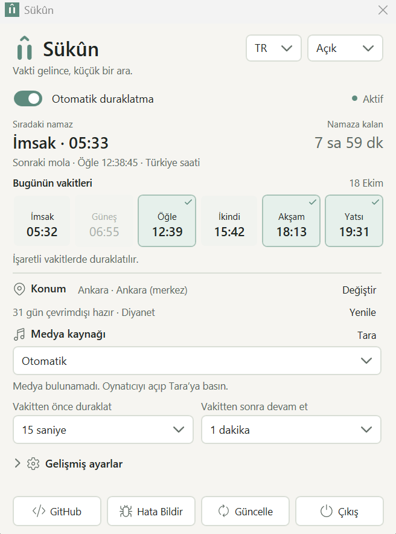
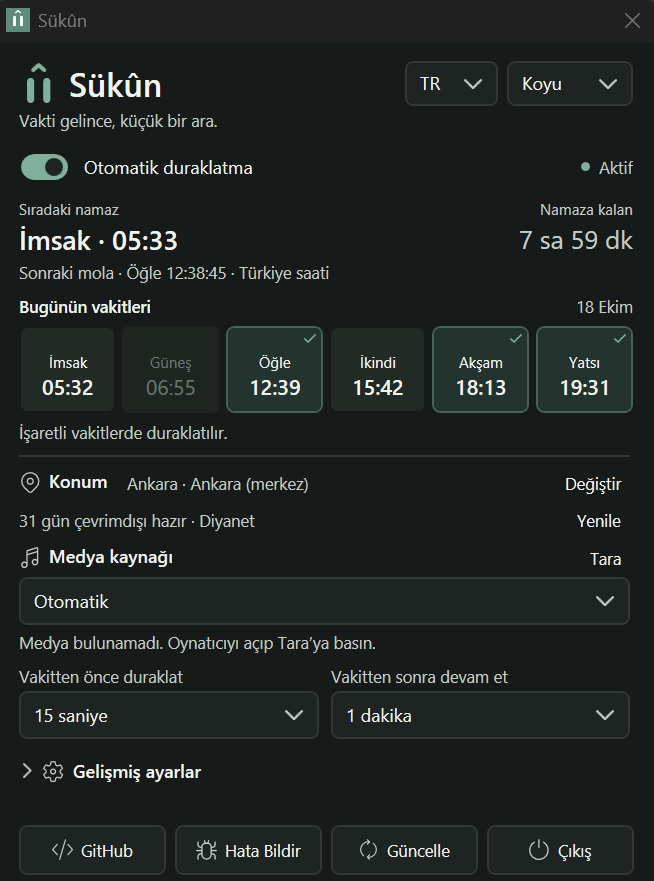
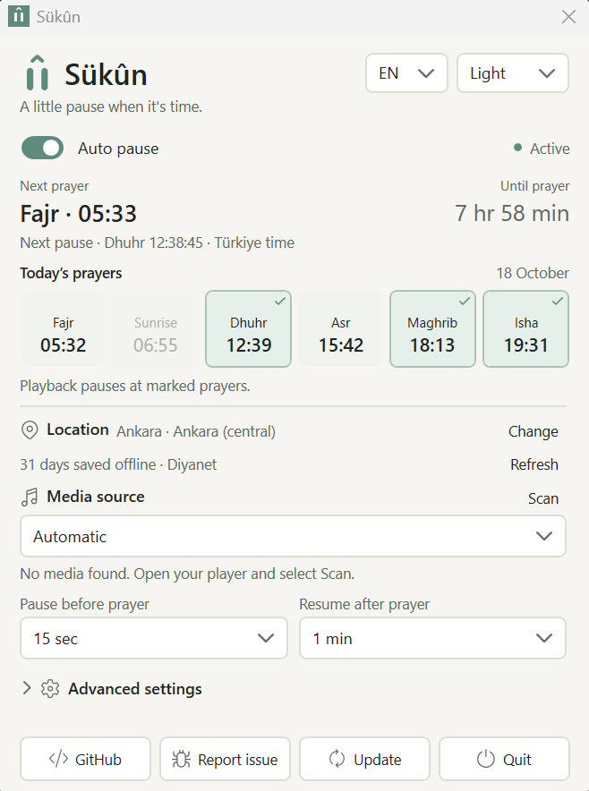
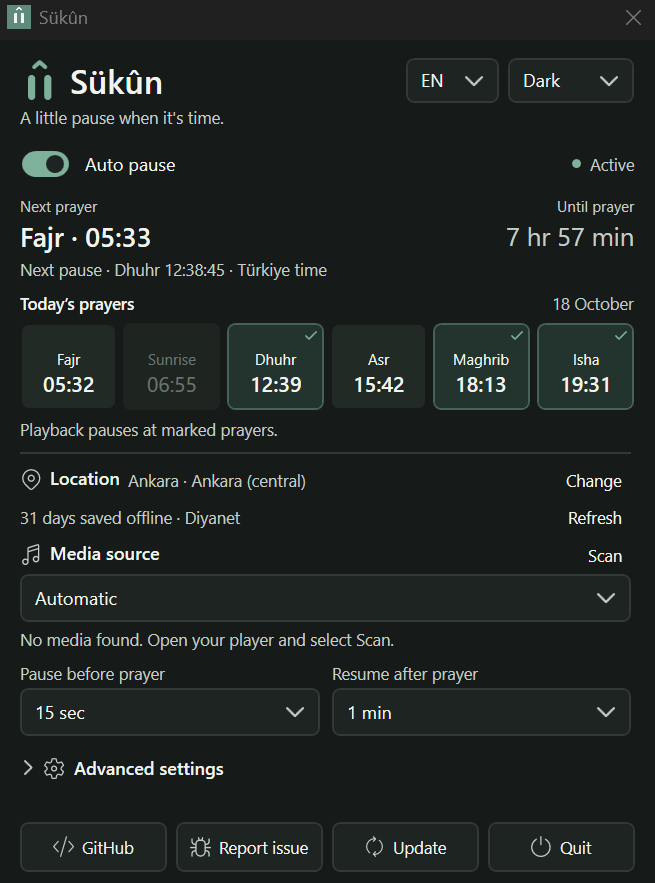

<p align="center"></p>

# Sükûn

[TR — Türkçe](#tr--türkçe) · [EN — English](#en--english)

## TR — Türkçe

**Vakti gelince, küçük bir ara.**

Sükûn, namaz vakti geldiğinde bilgisayarınızda çalan müziğe veya videoya ara veren küçük bir Windows uygulamasıdır. Seçtiğiniz süre dolunca, yalnızca kendisinin duraklattığı yayını devam ettirir. Spotify, YouTube Music ve diğer oynatıcılarla çalışması, oynatıcının Windows medya kontrollerini desteklemesine bağlıdır.

**[Windows için indir](https://talhay61.github.io/sukun/)** · [Hata bildir veya öneri gönder](https://github.com/TalhaY61/sukun/issues/new/choose)

Ücretsiz, reklamsız ve açık kaynaklıdır. Hesap açmanız veya .NET kurmanız gerekmez. **Windows 10 (2004 veya sonrası) ve Windows 11, x64** desteklenir. Şimdilik Türkiye için Diyanet vakitlerini kullanır.

> **İlk deneme sürümü: v0.1.0-beta.5.** Henüz kararlı sürüm değildir ve dijital olarak imzalanmamıştır. Windows bazı bilgisayarlarda uyarı gösterebilir veya çalışmasını engelleyebilir.

| Açık tema | Koyu tema |
| :---: | :---: |
|  |  |

### Nasıl kullanılır?

1. İndirme sayfasından **Sukun-win-x64.exe** dosyasını indirin. Kalıcı bir klasöre koyup çift tıklayın. ZIP indirirseniz önce içindeki dosyaları çıkarın.
2. **Konum seç** ile ilinizi ve vakit bölgenizi seçin. Vakitler ilk kez internetten alınır; kaydedilen tarihlerde internet olmasa da çalışır. Her idari ilçe Diyanet’te ayrı bir vakit bölgesi olmayabilir.
3. Kontrol edilecek medya kaynağını, mola verilecek namazları ve mola süresini seçin. **Otomatik** seçeneği yalnızca tek kaynak çalıyorsa onu kontrol eder; birden fazla kaynak çalıyorsa birini kendiniz seçin.
4. **Otomatik duraklatma** anahtarını açın. Uygulama yalnızca işaretlediğiniz vakitlerde ara verir. Ezanı dinleyerek bitişini algılamaz; seçtiğiniz süreyi kullanır.
5. Penceredeki **X** uygulamayı sağ alttaki bildirim alanına gizler. Simgeye tıklayarak yeniden açabilirsiniz. Tamamen kapatmak için **Çıkış**’ı kullanın.

Konum, dil ve diğer tercihleriniz kaydedilir. Türkçe ve İngilizce arasında yeniden başlatmadan geçebilirsiniz. Bilgisayarın açık, uyanık ve Sükûn’un çalışıyor olması gerekir. Etkinlikte, spor salonunda veya kafede kullanmadan önce kendi oynatıcınızla deneyin; bu beta gözetimsiz işletme kullanımı için henüz doğrulanmamıştır.

### Yeni sürümler ve gizlilik

Gelişmiş ayarlardan **Yeni uygulama sürümlerini denetle** seçeneğini açarsanız günde bir kontrol yapılır. Yeni sürüm bulunduğunda Windows bildirim ayarlarına bağlı olarak haber verilir. **Güncelle** düğmesi onayınızla indirme sayfasını açar; uygulama kendini otomatik kurmaz veya yeniden başlatmaz.

Ayarlar ve sınırlı hata günlükleri cihazınızda kalır. Telemetri, reklam ve otomatik hata gönderimi yoktur. Vakitleri almak için Diyanet’e, isteğe bağlı sürüm kontrolü için GitHub’a bağlanır.

[Gizlilik bilgileri](PRIVACY.md) · [MIT lisansı](LICENSE) · [Üçüncü taraf bildirimleri](THIRD_PARTY_NOTICES.md)

### Hata bildirmek veya katkıda bulunmak

Yazılım bilmeniz gerekmez: [hata ve öneri sayfasında](https://github.com/TalhaY61/sukun/issues/new/choose) uygun formu seçip ne olduğunu anlatabilirsiniz. Göndermek için ücretsiz bir GitHub hesabı gerekir; uygulamayı indirmek ve kullanmak için gerekmez. Eklediğiniz yazı ve dosyalar herkese açık olur; özel bilgilerinizi paylaşmayın.

Kod katkısı yapmak isteyenler projeyi kendi GitHub hesaplarına kopyalayıp (**Fork**) değişiklik önerisi (**Pull Request**) gönderebilir. Öneriler incelendikten sonra projeye alınır; indiren kişilere doğrudan kod değiştirme yetkisi verilmez. [Katkı rehberi](CONTRIBUTING.md).

<details>
<summary>Geliştiriciler için</summary>

Windows ve .NET 10 SDK gerekir. Mevcut yapı WPF ve C# kullanır.

```powershell
dotnet build Sukun.sln -c Release
dotnet run --project tests/Sukun.Tests -c Release
dotnet run --project src/Sukun.Windows -c Release
./scripts/publish.ps1
```

Yayın betiği `artifacts/` altında EXE, ZIP ve SHA256 sağlama toplamlarını üretir. [Beta doğrulama notları](docs/BETA-VERIFICATION.md).

</details>

### Dijital imza

Mevcut beta imzasızdır. İmzalama altyapısı hazırlanmıştır; sertifika veya imzalama hizmeti onayı henüz alınmamıştır. [İmzalama hazırlığı ve yayın süreci](docs/CODE_SIGNING.md) geliştiriciler için İngilizce teknik ayrıntıları içerir.

Geliştiren: [Talha — @justtalha_](https://x.com/justtalha_).

---

## EN — English

**A little pause when it's time.**

Sükûn is a small Windows app that pauses music or video at prayer time. After your chosen interval, it resumes only playback that it successfully paused. Compatibility with Spotify, YouTube Music and other players depends on their support for Windows media controls.

**[Download for Windows](https://talhay61.github.io/sukun/)** · [Report a problem or suggest a feature](https://github.com/TalhaY61/sukun/issues/new/choose)

Free, ad-free and open source. No account or .NET installation needed. Supports **Windows 10 (2004 or later) and Windows 11, x64**. Currently uses Diyanet prayer times for locations in Türkiye.

> **Preview release: v0.1.0-beta.5.** This is not a stable release and is not digitally signed. Windows may display a warning or block it on some computers.

| Light theme | Dark theme |
| :---: | :---: |
|  |  |

### Getting started

1. Download **Sukun-win-x64.exe** from the download page. Keep it in a permanent folder and double-click it. If you download the ZIP instead, extract its contents first.
2. Use **Choose location** to select your province and prayer-time area. The first download requires internet; saved dates work offline. Diyanet does not list every administrative district as a separate prayer-time area.
3. Choose your media source, prayers and pause duration. **Automatic** controls playback only when exactly one source is playing. If several sources are playing, choose one yourself.
4. Enable **Auto pause**. Breaks apply only to the prayers you select. The app uses your chosen duration; it does not listen for the end of the adhan.
5. **X** hides the window in the notification area at the bottom right of Windows. Click its icon to reopen it. Use **Quit** to exit completely.

Your location, language and preferences are saved. Switch between English and Turkish without restarting. Your PC must be awake with Sükûn running. Try your own player before using it at an event, gym or café; unattended venue operation has not been validated for this beta.

### Updates and privacy

Enable **Check for app updates** in Advanced settings for daily checks. New releases trigger a notice, subject to Windows notification settings. **Update** asks before opening the download page; it does not install updates or restart the app automatically.

Settings and bounded diagnostic logs stay on your device. No telemetry, advertising or automatic crash uploads. Prayer downloads contact Diyanet; optional update checks contact GitHub.

[Privacy information](PRIVACY.md) · [MIT license](LICENSE) · [Third-party notices](THIRD_PARTY_NOTICES.md)

### Feedback and contributions

You do not need coding knowledge to help: open the [feedback page](https://github.com/TalhaY61/sukun/issues/new/choose), choose a form and describe your problem or idea. A free GitHub account is required to submit feedback, but not to download or use the app. Reports and attachments are public; leave out private information. Reports in Turkish or English are welcome.

Developers can **fork** the repository, make changes in their own copy and submit a **pull request** for review. Downloading the app does not grant direct access to change the project. See the [contribution guide](CONTRIBUTING.md).

<details>
<summary>For developers</summary>

Requires Windows and the .NET 10 SDK. The app uses WPF and C#.

```powershell
dotnet build Sukun.sln -c Release
dotnet run --project tests/Sukun.Tests -c Release
dotnet run --project src/Sukun.Windows -c Release
./scripts/publish.ps1
```

The publish script creates the EXE, ZIP and SHA256 checksums in `artifacts/`. See the [beta verification notes](docs/BETA-VERIFICATION.md).

</details>

### Code signing

The current beta is unsigned. Signing preparation is in place, but no certificate or signing-service approval has been obtained. See the [signing preparation and release process](docs/CODE_SIGNING.md).

Made by [Talha — @justtalha_](https://x.com/justtalha_).
